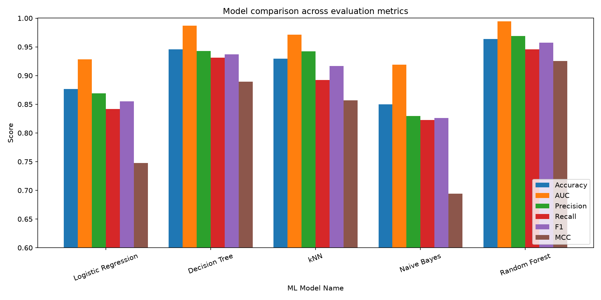
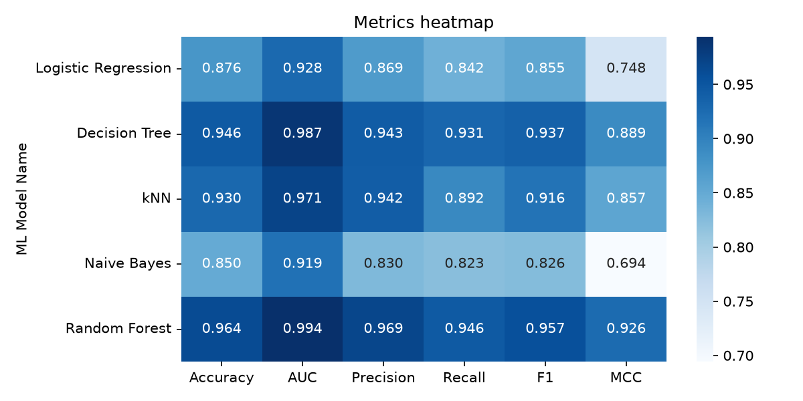

# Airline Passenger Satisfaction – Classification Models

## a. Problem statement
This project builds and compares five classification models to predict whether an airline passenger is satisfied or neutral/dissatisfied with their flight experience, using passenger demographics, travel details, flight delays and airline service ratings. Accurately predicting passenger satisfaction helps airlines identify dissatisfied customers, improve service quality, strengthen customer loyalty and make data-driven business decisions. The models are evaluated on a held-out test set using accuracy, AUC, precision, recall, F1 and MCC.

## b. Dataset description
- **Source:** Kaggle – Airline Passenger Satisfaction (teejmahal20), file `train.csv`
- **Link:** https://www.kaggle.com/datasets/teejmahal20/airline-passenger-satisfaction
- **Size:** 103,904 rows, 25 columns (22 features after dropping `Unnamed: 0` and `id`, plus target `satisfaction`)
- **Target:** `satisfaction` (1 = satisfied, 0 = neutral or dissatisfied)
- **Feature types:** 4 categorical (Gender, Customer Type, Type of Travel, Class); 18 numeric (Age, Flight Distance, 14 service ratings from 0–5, Departure Delay, Arrival Delay)
- **Missing values:** 310 in `Arrival Delay in Minutes`, filled with the median (fitted on training data only)
- **Duplicates:** 0
- **Class distribution:** neutral or dissatisfied 58,879 (56.7%), satisfied 45,025 (43.3%), mildly imbalanced, so the split was stratified
- **Imbalance handling:** the 57/43 split is mild, so I used a stratified split and did not resample; F1 and MCC are reported alongside accuracy.
- **Test data:** `test_data.csv` holds the 20,781 held-out rows (20% split, seed 42) with all raw features and the target `satisfaction` (1 = satisfied).
- **Why chosen:** I chose this dataset because it meets all the assignment requirements, with over 100,000 records and 22 features. It contains a good mix of numerical and categorical data, along with a small number of missing values and some class imbalance, making it suitable for practising data preprocessing and classification techniques. I also found the topic of predicting passenger satisfaction interesting and easy to understand, making it a good choice for comparing different machine learning models.

### Preprocessing
- Dropped `Unnamed: 0` and `id`
- 80:20 stratified train-test split, `random_state=42`
- Median imputation and StandardScaler for numeric columns; One-Hot Encoding for categorical columns
- All transformers were fitted on the training set only, then applied to the test set

## c. GitHub repository
https://github.com/2026ct05144-sys/ml-assignment-2

### How to run
1. Clone the repo and download `train.csv` from the Kaggle link above into the project root
2. `python3 -m venv venv && source venv/bin/activate`
3. `pip install -r requirements.txt`
4. `jupyter notebook`, then open `model/classification.ipynb` and run all cells

## d. Models used

All metrics use "satisfied" (1) as the positive class. Models use default or common hyperparameter values and were not tuned, so rankings could change with tuning.
### Model configurations
| Model | Settings |
|---|---|
| Logistic Regression | max_iter=1000, random_state=42 |
| Decision Tree | max_depth=10, random_state=42 |
| kNN | n_neighbors=5 |
| Naive Bayes | GaussianNB (defaults) |
| Random Forest | n_estimators=100, random_state=42 |

### Comparison table
| ML Model Name | Accuracy | AUC | Precision | Recall | F1 | MCC |
|---|---|---|---|---|---|---|
| Logistic Regression | 0.8765 | 0.9281 | 0.8692 | 0.8418 | 0.8552 | 0.7479 |
| Decision Tree | 0.9456 | 0.9868 | 0.9428 | 0.9309 | 0.9368 | 0.8891 |
| kNN | 0.9296 | 0.9710 | 0.9423 | 0.8921 | 0.9165 | 0.8566 |
| Naive Bayes | 0.8499 | 0.9188 | 0.8295 | 0.8228 | 0.8261 | 0.6941 |
| Random Forest (Ensemble) | 0.9638 | 0.9941 | 0.9695 | 0.9461 | 0.9577 | 0.9262 |

*Results were verified on the BITS Virtual Lab. Random Forest values differ very slightly from my local run because of library versions.*

### Graphs

### Observations
| ML Model Name | Observation about model performance |
|---|---|
| Logistic Regression | Reached 87.65% accuracy with an MCC of 0.7479. Its train and test accuracy are almost identical (87.50% and 87.65%), so it is not overfitting; it is simply limited by its linear decision boundary, which cannot capture interactions between the service ratings. It still makes a reasonable, fast baseline. |
| Decision Tree | Scored 94.56% accuracy and a recall of 0.9309, a big jump over the linear model. With max_depth=10 it generalises well (train 94.90%, test 94.56%), and it can learn non-linear rules from the service ratings. Its AUC of 0.9868 shows it ranks satisfied passengers well. |
| kNN | Reached 92.96% accuracy. Precision is high (0.9423) but recall is lower (0.8921), so it misses more satisfied passengers than the tree-based models. Train accuracy (94.79%) is higher than test (92.96%), a mild sign of overfitting. It relies on the feature scaling applied earlier and is slow to predict on a dataset of this size. |
| Naive Bayes | Had the weakest results, with 84.99% accuracy and an MCC of 0.6941. It assumes features are independent, but many service ratings are correlated, and Gaussian assumptions fit one-hot encoded columns poorly. Its AUC (0.9188) is better than its accuracy suggests, so its ranking of passengers is reasonable even if its hard predictions are not. |
| Random Forest (Ensemble) | Performed best on every metric: 96.38% accuracy, AUC 0.9941, F1 0.9577 and MCC 0.9262. Averaging many trees reduces the variance of a single tree. It reached 100% training accuracy in my local run against 96.38% on the test set, so it overfits slightly, but its test performance is still the highest. |
| **Overall winner for your dataset?** | **Random Forest.** It has the best accuracy, AUC, precision, recall, F1 and MCC. The high MCC (0.9262) shows it performs well on both classes despite the 57/43 class split. The models were not tuned, so rankings could change with hyperparameter tuning. |
